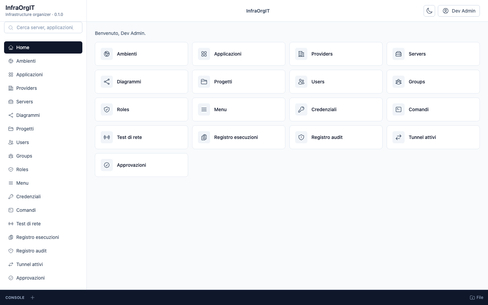

# InfraOrgIT Docker

Run InfraOrgIT with Docker Compose: the web app, API, MySQL and Keycloak on
one origin. Use it for a local installation, a demo or the source-based
development stack; for a production server, use the published-image stack in
[AllInfraOrgIT/deploy](https://github.com/SenseiKiritof/AllInfraOrgIT/tree/main/deploy).



The screenshot uses fictitious demo data, not a real installation.

## Start

Requirements: Docker Engine with Compose v2, and `make` for the commands below.
`make dev` also needs .NET SDK 10, Node 24 and Yarn 1.22; `make full` only
needs Docker.

### Local source stack

```bash
git clone https://github.com/SenseiKiritof/AllInfraOrgIT.git
git clone https://github.com/SenseiKiritof/InfraOrgITApi.git
git clone https://github.com/SenseiKiritof/InfraOrgITWeb.git
git clone https://github.com/SenseiKiritof/InfraOrgITDocker.git
cd AllInfraOrgIT
make dev
```

`make dev` creates `InfraOrgITDocker/.env` when it is missing, starts MySQL and
Keycloak, applies the EF migrations, then starts the API on `:5298` and Vite on
`:3000`. Open <http://localhost:3000>.

### Single Compose stack

```bash
cd AllInfraOrgIT
make full
```

`make full` builds the API and web images, runs the migration job, starts
Keycloak in production mode and serves the app through Caddy on
<https://localhost:8443>. The first start can take a minute while the images
are built and the realm is imported.

## Sign in

The development realm seeds the application user from
`keycloak/realm-infraorgit.json`:

- application user `admin`
- password `dev-admin`

The Keycloak master administrator is separate, from `InfraOrgITDocker/.env`:
`KEYCLOAK_ADMIN` / `KEYCLOAK_ADMIN_PASSWORD` (default `dev-keycloak-admin`) for
the admin console on `:18081/admin`.

These credentials are for development only. In production the deploy
preflight refuses the default password and the bootstrap admin must change it
at first login.

## What is included

- **Web UI** on `:8443` (full stack) or `:3000` (Vite): inventory, diagrams,
  SSH console, file transfer, reachability tests, MCP approvals, tunnels and
  audit.
- **API** with MCP at `/mcp`.
- **Keycloak** on `:18081` for identity; MFA is opt-in with
  `KEYCLOAK_MFA=true`. The public desktop client can request `offline_access`;
  offline sessions are bounded to 30 days idle and 90 days maximum.
- **MySQL** for the application and a second MySQL for Keycloak.
- **HTTPS** on the full stack through Caddy; the certificate is local and
  self-signed.

The database initializes itself on an empty volume. `make reset` deletes the
Compose volumes and `InfraOrgITDocker/data`: use it when you change the
Keycloak realm, the clients or the init scripts, and remember that it destroys
local data.

## Operate it

- [`docs/OPERATIONS.md`](docs/OPERATIONS.md) — services, ports, database init
  scripts, image builds, reset and production notes.
- [`../AllInfraOrgIT/deploy/README.md`](../AllInfraOrgIT/deploy/README.md) —
  production stack from published images, secrets, TLS, backups and updates.
- [`../AllInfraOrgIT/docs/operations/backup-restore.md`](../AllInfraOrgIT/docs/operations/backup-restore.md)
  — backup and restore procedure.
- [`../AllInfraOrgIT/docs/security/transport.md`](../AllInfraOrgIT/docs/security/transport.md)
  — HTTPS, FTP/FTPS and local transport notes.

The source code lives in
[InfraOrgITApi](https://github.com/SenseiKiritof/InfraOrgITApi) and
[InfraOrgITWeb](https://github.com/SenseiKiritof/InfraOrgITWeb); the desktop
companion is
[InfraOrgITDesktop](https://github.com/SenseiKiritof/InfraOrgITDesktop).
